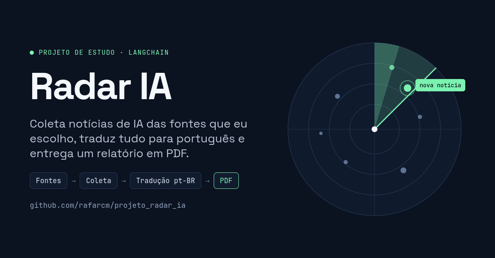

# projeto_radar_ia

Coleta notícias recentes sobre Inteligência Artificial **somente das fontes que você cadastra**, traduz e resume tudo em **português do Brasil** com LangChain, gera um **PDF** e, se você quiser, envia por **e-mail** e **Telegram**.

```
fontes.yaml ─▶ coleta (RSS/Atom) ─▶ deduplicação (título + significado) + histórico (SQLite)
           ─▶ LLM: tradução + resumo + tema + relevância (saída estruturada)
           ─▶ verificações de idioma/fidelidade (laço de revisão) ─▶ PDF ─▶ e-mail / Telegram
```

Para começar rápido no Linux, use o atalho [`./radar.sh`](#atalho-radarsh-linux).

O fluxo é orquestrado com **LangGraph** (detalhes em [Como funciona](#como-funciona-langgraph)).

## Custos

O único custo do radar é o **uso da API do LLM** (ex.: Anthropic), cobrado por token. Todo o resto é gratuito e não exige cadastro:

| Componente | Custo |
|---|---|
| LangChain e LangGraph | grátis (bibliotecas open source, licença MIT). O radar **não** usa o LangGraph Platform nem o LangSmith, que são serviços pagos opcionais |
| Deduplicação semântica | grátis: o modelo roda na sua máquina; o download (~220 MB) vem do Hugging Face sem conta |
| Histórico no GitHub | grátis: fica num branch do próprio repositório |
| GitHub Actions | grátis em repositório público; em repositório privado, a cota gratuita é de 2.000 min/mês, e o radar usa cerca de 3 min/dia |
| E-mail (Gmail/Outlook) e Telegram | grátis |

## Instalação

Requer Python 3.11 ou superior.

```bash
git clone <seu-repo> radar-ia && cd radar-ia
python -m venv .venv && source .venv/bin/activate
pip install -e ".[dev]"
cp .env.example .env        # e preencha as chaves
```

Para os acentos e caracteres especiais saírem perfeitos no PDF, o radar usa a fonte DejaVu Sans se estiver instalada (`sudo apt install fonts-dejavu-core` no Debian/Ubuntu). Sem ela, usa Helvetica, que também cobre os acentos do português.

## Atalho: `radar.sh` (Linux)

O script [radar.sh](radar.sh) reúne os comandos mais usados. Ele cria o ambiente virtual e instala as dependências sozinho na primeira vez, e avisa se faltar alguma variável no `.env` (sem mostrar os valores).

```bash
./radar.sh              # abre um menu numerado
./radar.sh <comando>    # roda um comando direto
```

| Comando | O que faz | Custo |
|---|---|---|
| `./radar.sh instalar` | cria o `.venv`, instala as dependências e cria o `.env` a partir do `.env.example`, se ainda não existir | grátis |
| `./radar.sh fontes` | testa se os feeds cadastrados respondem | grátis |
| `./radar.sh simular` | mostra o que seria processado, sem chamar o LLM | grátis |
| `./radar.sh testar-email` | envia uma mensagem de teste por cada canal ativo (e-mail/Telegram) | grátis |
| `./radar.sh teste` | relatório pequeno com 3 notícias: gera o PDF e envia | centavos |
| `./radar.sh pdf` | relatório completo, só o PDF (sem enviar) | uso da API |
| `./radar.sh gerar` | relatório completo: gera o PDF e envia | uso da API |
| `./radar.sh retomar` | continua a última execução interrompida | só o que faltou |
| `./radar.sh abrir` | abre o PDF mais recente | grátis |
| `./radar.sh testes` | roda os testes automatizados (sem APIs reais) | grátis |
| `./radar.sh ajuda` | lista os comandos | grátis |

Opções extras são repassadas para `radar gerar` (veja a tabela de opções em [Uso rápido](#uso-rápido)):

```bash
./radar.sh gerar --horas 48
./radar.sh pdf --max-itens 10 --verificar-traducao
./radar.sh simular --ignorar-historico
```

**Primeiro uso, passo a passo:**

```bash
./radar.sh instalar       # 1. instala e cria o .env
#                           2. preencha o .env (chave da API e e-mail) e o config.yaml
./radar.sh simular        # 3. confere a coleta, sem custo
./radar.sh testar-email   # 4. confere o e-mail
./radar.sh teste          # 5. relatório pequeno de verdade
./radar.sh abrir          # 6. abre o PDF gerado
```

As 3 notícias do `teste` entram no histórico e não se repetem no relatório seguinte. Para incluí-las de novo, use `./radar.sh gerar --ignorar-historico`.

Se aparecer `Permissão negada`, torne o script executável com `chmod +x radar.sh`.

## Uso rápido

```bash
radar fontes testar                 # confere se os feeds respondem
radar gerar --simular               # mostra o que seria processado, sem chamar o LLM (custo zero)
radar gerar --sem-enviar            # gera só o PDF em relatorios/radar-ia_AAAA-MM-DD_HHMM.pdf
radar gerar                         # gera e envia pelos canais ativos
```

Opções de `radar gerar`:

| Opção | Efeito |
|---|---|
| `--horas 24` | janela de tempo (padrão em `config.yaml`) |
| `--max-itens 40` | máximo de notícias enviadas ao LLM (controle de custo) |
| `--simular` | coleta e lista os itens, sem LLM e sem PDF |
| `--sem-enviar` | só gera o PDF |
| `--verificar-traducao` | segunda chamada ao LLM por item para revisar a fidelidade (dobra o custo) |
| `--texto-completo` | baixa o texto de **todos** os artigos com trafilatura, respeitando robots.txt (por padrão, o artigo só é baixado quando o feed não traz detalhes suficientes; veja abaixo) |
| `--ignorar-historico` | inclui notícias que já saíram em relatórios anteriores |
| `--retomar` | continua a última execução interrompida de onde parou, sem refazer as traduções já prontas |
| `-v` / `--verbose` | logs detalhados (use antes do comando: `radar -v gerar`) |

Códigos de saída: `0` sucesso, `1` erro (configuração, fontes, idioma), `3` o PDF foi gerado mas algum canal de entrega falhou.

## Configuração

- **`.env`**: segredos e modelo. Nunca vai para o Git.
  - `RADAR_MODELO`: modelo no formato do LangChain `provedor:modelo`. Padrão: `anthropic:claude-opus-5-5`. Para baratear, use, por exemplo, `anthropic:claude-sonnet-5-5` ou `anthropic:claude-haiku-5-5`. Para trocar de provedor (ex.: `openai:...`), instale o pacote do provedor (`pip install langchain-openai`) e defina a chave correspondente.
  - `ANTHROPIC_API_KEY`, `SMTP_*`, `EMAIL_DESTINATARIOS` e `TELEGRAM_*`.
- **`config.yaml`**: janela de tempo, limites, limiar de duplicidade (`deduplicacao.limiar_titulo`, de 0 a 100), concorrência, pasta de saída, caminho do SQLite e canais de entrega.

## Fontes (`fontes.yaml`)

Cada fonte tem `nome`, `url` (feed RSS/Atom), `categoria` (opcional), `ativa` (true/false) e `peso` (1 a 5; pesa na escolha dos destaques). O radar **nunca** usa fontes fora dessa lista.

Edite o arquivo à mão ou use a linha de comando, que preserva os comentários:

```bash
radar fontes listar
radar fontes adicionar "Meu Blog" https://exemplo.com/feed.xml --categoria imprensa --peso 3
radar fontes desativar "arXiv cs.AI"
radar fontes ativar "arXiv cs.AI"
radar fontes remover "Meu Blog"
radar fontes testar            # só ativas; --todas inclui as inativas
```

Erros no arquivo aparecem em português, indicando a fonte e o campo, por exemplo: `fonte #3 ('Mistral AI'), campo 'peso': deve ser no máximo 5`.

**Filtro por palavras-chave (opcional e grátis):** acrescente `palavras_chave` a uma fonte para aceitar só os itens cujo título ou resumo contenha ao menos um dos termos. Os termos casam como palavras inteiras, sem diferenciar maiúsculas. Útil para fontes volumosas como o arXiv; há um exemplo comentado no `fontes.yaml`:

```yaml
  - nome: arXiv cs.AI
    url: https://rss.arxiv.org/rss/cs.AI
    palavras_chave: [LLM, language model, agent, reasoning, alignment, safety]
```

Quando há mais notícias que `--max-itens`, a seleção alterna entre as fontes (das de maior peso para as de menor), para que uma fonte volumosa como o arXiv não ocupe todo o limite.

## Deduplicação

1. **Por URL** (sem parâmetros de rastreamento como `utm_*`) e **por título parecido** (`deduplicacao.limiar_titulo`).
2. **Por significado** (`deduplicacao.semantica: true`): pega a mesma notícia contada com outras palavras por veículos diferentes, como "OpenAI now trains its frontier AI models with no internet access" (The Verge) e "OpenAI says it will no longer train its AI models on the live internet" (TechCrunch). Usa um modelo de embeddings multilíngue que roda **localmente** (fastembed/ONNX, sem GPU e sem API paga). Na primeira execução, o modelo (~220 MB) é baixado para `~/.cache/radar-ia/modelos`.
   - Só compara notícias de **fontes diferentes**: uma fonte não repete a mesma notícia, e artigos do arXiv sobre temas próximos eram os falsos positivos.
   - O limiar padrão (`limiar_semantico: 0.70`) foi calibrado com 48h de notícias reais: pegou as 4 duplicatas reais e nenhum falso positivo. Se notícias diferentes estiverem sendo descartadas, aumente o limiar; os descartes aparecem no log como `duplicado_semantico`.
   - Se o modelo não puder ser baixado (sem internet, por exemplo), o radar segue sem essa etapa e registra um aviso.
3. **Histórico**: notícias que já saíram em relatórios anteriores não se repetem.

Entre duplicados, fica o item da fonte de maior `peso`.

## Idioma: tudo em português do Brasil

1. **Detecção** com `langdetect`. Com texto curto ou pouca confiança, usa o idioma declarado pelo feed; se ainda for ambíguo, o LLM identifica.
2. **Tradução e resumo numa única chamada** estruturada (`titulo_pt`, `resumo_pt`, `idioma_original`, `foi_traduzido`, `tema`, `relevancia`). Textos já em português só são padronizados para pt-BR.
3. **Verificação automática** de cada item: o texto gerado é detectado de novo (precisa ser português); números do título original precisam continuar no título traduzido; números e URLs que não existem no original são apontados; o glossário é conferido. Havendo problema, o item é refeito com o motivo explicado ao modelo (até `max_tentativas_traducao` vezes).
   - Se o português continuar falhando, o item vira **"Tradução indisponível"**: o relatório mostra só o título original e o link, e o caso fica no log.
   - Se o problema for de fidelidade (número, URL, glossário), o item é publicado com um **aviso** visível no PDF.
4. **`--verificar-traducao`** (opcional): um segundo passo do LLM compara original e tradução e aponta perda ou invenção de informação.
5. **Checagem final** antes do PDF: visão geral, destaques, resumos e temas passam por uma última verificação. O que não estiver em português usa o fallback acima; se ainda sobrar algo, a geração do PDF é **bloqueada** com uma mensagem indicando o item.
6. **Cache de traduções** no SQLite (chave: URL normalizada + hash do conteúdo + versão do glossário + modelo), para não pagar duas vezes pela mesma tradução.

O link de cada notícia vem sempre do feed, nunca do LLM.

### Como funciona (LangGraph)

O pipeline é um grafo do [LangGraph](https://github.com/langchain-ai/langgraph) ([radar_ia/fluxo.py](radar_ia/fluxo.py)):

```
coletar ─▶ selecionar ─┬─▶ (--simular: fim)
                       ├─▶ texto_completo (--texto-completo)
                       └─▶ traduzir_item × N (em paralelo) ─▶ montar_relatorio ─▶ checagem_final
                                                          ─▶ gerar_pdf ─▶ registrar_historico ─▶ entregar
```

Cada notícia passa por um subgrafo com o **laço de revisão** explícito:

```
preparar (idioma + cache) ─▶ gerar (LLM) ─┬─▶ aprofundar (feed insuficiente) ─▶ gerar (com o artigo)
                                          └─▶ verificar ─┬─▶ gerar   (rejeitado e ainda há tentativas)
                                                         └─▶ concluir (aprovado, com aviso ou "tradução indisponível")
```

O primeiro resumo é feito só com o título e o resumo do feed. Se o LLM indicar que faltam detalhes (`conteudo_suficiente: false`, comum em feeds que trazem só uma frase), `aprofundar` baixa o artigo pelo link da notícia (trafilatura, respeitando robots.txt) e o resumo é refeito com o texto completo. Isso custa uma chamada a mais ao LLM só nesses itens. Se o artigo não puder ser baixado, fica o resumo do feed. Para desligar, use `processamento.buscar_artigo_se_insuficiente: false` no `config.yaml`.

Cada etapa concluída fica salva em `dados/checkpoints.sqlite3`. Se a execução cair no meio (falta de rede, limite da API, Ctrl+C), rode `radar gerar --retomar` para continuar de onde parou com as mesmas opções e a mesma janela de tempo. As notícias já traduzidas não são refeitas. Um `radar gerar` novo descarta a execução interrompida anterior.

### Glossário (`glossario.yaml`)

```yaml
versao: 1
termos:
  - termo: fine-tuning
    manter: true                    # não traduzir
  - termo: open source
    traduzir_como: "código aberto"  # sempre essa tradução
```

Cada termo tem **uma** regra. O glossário entra no prompt e é conferido depois: se um termo com `traduzir_como` continuar em inglês, o item é refeito. **Ao mudar o glossário, aumente `versao`** para invalidar o cache de traduções.

## Relatório em PDF

Gerado com **reportlab**, que instala só com pip, sem as bibliotecas de sistema (Pango/Cairo) que o weasyprint exige. Conteúdo: capa com o período, visão geral, destaques do dia (3 a 5, combinando a relevância dada pelo LLM com o peso da fonte), notícias agrupadas por tema com título clicável, fonte, data e resumo, a marca "Traduzido do inglês" com o título original em fonte menor, a seção "Fontes que falharam" e um rodapé com a data de geração e o aviso de que o conteúdo foi gerado por IA.

## Entrega automática

Ative cada canal em `config.yaml` (`entrega.email.ativo`, `entrega.telegram.ativo`). Se nenhum estiver ativo, o PDF é apenas salvo. A falha de um canal não impede o outro nem apaga o PDF; tokens e senhas nunca aparecem nos logs.

```bash
radar testar-entrega       # envia uma mensagem de teste para cada canal ativo
```

### E-mail (SMTP)

No `.env`: `SMTP_HOST`, `SMTP_PORTA` (587 para STARTTLS ou 465 para SSL), `SMTP_USUARIO`, `SMTP_SENHA` e `EMAIL_DESTINATARIOS` (um ou mais destinatários separados por vírgula, ex.: `voce@gmail.com,outra@exemplo.com`; ficam no `.env` para que seus endereços não vão para o Git). O assunto (`{data}` vira dd/mm/aaaa) fica em `config.yaml`. O e-mail tem versão em texto simples e em HTML, com a visão geral e os destaques, e leva o PDF anexado.

**Use uma senha de app, nunca a senha principal:**

- **Gmail** (`smtp.gmail.com`, porta 587): ative a verificação em duas etapas na Conta Google, abra <https://myaccount.google.com/apppasswords>, crie uma senha de app (ex.: "radar-ia") e cole os 16 caracteres em `SMTP_SENHA`.
- **Outlook.com / Hotmail** (`smtp-mail.outlook.com`, porta 587): ative a verificação em duas etapas em <https://account.microsoft.com/security>, vá em *Opções de segurança avançadas → Senhas de app → Criar nova senha de app* e use-a em `SMTP_SENHA`. Contas Microsoft 365 corporativas podem ter o SMTP autenticado desativado pelo administrador.

### Telegram

1. No Telegram, converse com **@BotFather**, envie `/newbot` e siga as instruções. Ele devolve o token: coloque em `TELEGRAM_BOT_TOKEN`.
2. Envie qualquer mensagem para o seu bot (ou adicione-o a um grupo e mande uma mensagem lá).
3. Abra `https://api.telegram.org/bot<SEU_TOKEN>/getUpdates` no navegador e copie o número em `"chat":{"id": ...}` para `TELEGRAM_CHAT_ID`. Em grupos, o id é negativo.

O bot envia primeiro uma mensagem com a visão geral e os destaques (dividida se passar de 4096 caracteres) e depois o PDF como documento.

## Agendamento

### GitHub Actions

O workflow [.github/workflows/radar.yml](.github/workflows/radar.yml) roda todo dia às **08:00 de Brasília** (`cron: "0 11 * * *"`, já que o cron do GitHub usa UTC: hora em SP + 3 = hora UTC). Também dá para disparar manualmente em *Actions → Radar IA diário → Run workflow*.

1. Em *Settings → Secrets and variables → Actions*, crie os **secrets** `ANTHROPIC_API_KEY`, `SMTP_HOST`, `SMTP_PORTA`, `SMTP_USUARIO`, `SMTP_SENHA`, `EMAIL_DESTINATARIOS`, `TELEGRAM_BOT_TOKEN` e `TELEGRAM_CHAT_ID` (só os dos canais que você usar).
2. Opcionalmente, crie a **variável** `RADAR_MODELO`.
3. Ative os canais no `config.yaml` e faça commit.

O PDF de cada execução fica disponível como *artifact* por 30 dias.

**Histórico entre execuções:** os runners do Actions começam vazios a cada vez. Por isso, o SQLite (histórico e cache de traduções) é guardado no branch **`radar-dados`** do próprio repositório, pelo script [scripts/historico_git.sh](scripts/historico_git.sh): é restaurado antes de `radar gerar` e salvo depois, mesmo se a execução falhar. Diferente do cache do Actions, o branch não expira. Ele tem sempre um único commit, recriado a cada execução, então o repositório não cresce dia após dia. O workflow precisa de `permissions: contents: write` (já configurado). Em repositório **público**, esse branch também é público: ele contém só títulos, links e traduções das notícias, sem nenhuma chave. Não apague o branch, a menos que queira zerar o histórico.

O modelo de embeddings fica no cache do Actions apenas para não ser baixado de novo a cada dia. Se o cache expirar, ele é baixado outra vez, sem custo.

### Cron local

Veja [exemplos/crontab.txt](exemplos/crontab.txt):

```cron
CRON_TZ=America/Sao_Paulo
0 8 * * * cd /caminho/para/radar-ia && .venv/bin/radar gerar >> logs/radar.log 2>&1
```

Também dá para usar o atalho no cron: `0 8 * * * /caminho/para/radar-ia/radar.sh gerar >> /caminho/para/radar-ia/logs/radar.log 2>&1` (crie a pasta `logs/` antes).

## Testes

```bash
pytest
```

Os testes não chamam nenhuma API real: o LLM, o SMTP e o Telegram são simulados (mocks).

## Solução de problemas

| Sintoma | O que fazer |
|---|---|
| `fonte #N (...) campo ...` | corrija o campo indicado no `fontes.yaml` |
| fonte aparece em "Fontes que falharam" | rode `radar fontes testar`; o feed pode ter mudado de endereço ou estar bloqueando o acesso (HTTP 403) |
| `Não foi possível iniciar o modelo` | confira `RADAR_MODELO` e a chave do provedor no `.env`; para outros provedores, instale o pacote `langchain-<provedor>` |
| muitos itens com "Tradução indisponível" | rode com `-v` para ver o motivo; pode ser erro de API (chave, limite de requisições) ou um modelo fraco demais para seguir as regras |
| `Geração do PDF bloqueada` | algum texto não ficou em português mesmo após o fallback; a mensagem indica o item. Rode de novo ou troque de modelo |
| nada novo no relatório | o histórico já registrou essas notícias; use `--ignorar-historico` ou aumente `--horas` |
| e-mail: `SMTPAuthenticationError` | use uma senha de app (veja acima), não a senha da conta |
| Telegram: `HTTP 400 chat not found` | mande uma mensagem ao bot antes e confira o `TELEGRAM_CHAT_ID` |
| custo alto | reduza `--max-itens`, use `palavras_chave` nas fontes volumosas, troque `RADAR_MODELO` por um modelo menor e deixe `--verificar-traducao` desligado |
| execução caiu no meio | `radar gerar --retomar` |
| notícias diferentes sumindo como duplicadas | aumente `deduplicacao.limiar_semantico` (ex.: 0.80) ou desative com `semantica: false`; veja `duplicado_semantico` no log |

## Estrutura

```
radar_ia/
  cli.py            linha de comando (typer)
  fluxo.py          grafos do LangGraph (pipeline e laço de revisão por item)
  config.py         config.yaml + .env
  fontes.py         cadastro e validação das fontes
  coleta.py         feeds, retentativas, janela de tempo, texto completo
  dedup.py          normalização de URL, duplicados (título e semântica), seleção por fonte
  armazenamento.py  SQLite: histórico e cache de traduções
  idioma.py         detecção, glossário, checagens de números/URLs
  processamento.py  LangChain: prompts, saída estruturada, verificações, destaques, visão geral
  pdf.py            relatório (reportlab)
  entrega/          e-mail e Telegram
radar.sh            atalhos de linha de comando para Linux
scripts/
  historico_git.sh  guarda o histórico no branch radar-dados (GitHub Actions)
tests/              pytest com mocks
```
